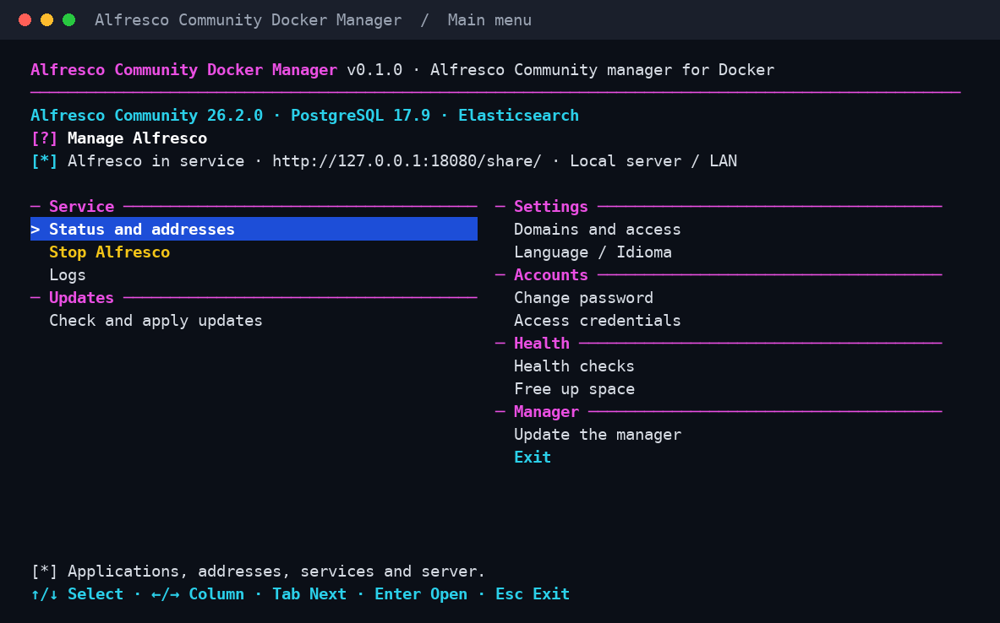
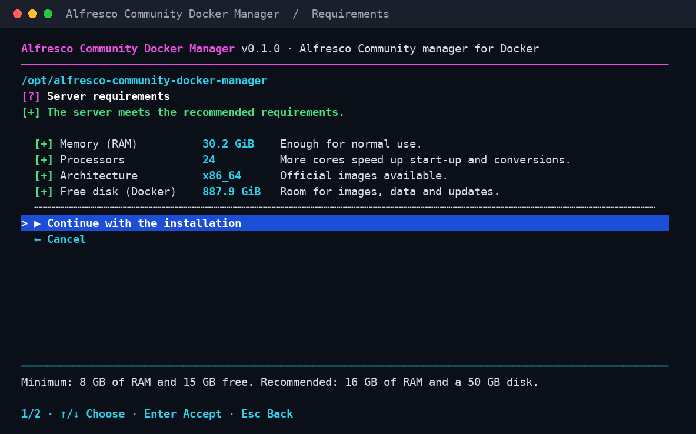

[Español](README.md) | **English**

# Alfresco Community Docker Manager

Install and manage **Alfresco Community** on your Linux server from a simple
menu, without writing configuration files. It uses Alfresco's official Docker
images and speaks English and Spanish.

Version **0.1.0** · [MIT License](LICENSE)



*Main menu with a running installation.*

## What you can do

- **Install Alfresco in minutes:** the manager downloads the newest official
  release and sets everything up: Share, Content App, Control Center,
  Elasticsearch search and a PostgreSQL database.
- **Stay safe from the start:** the factory `admin/admin` password is replaced
  with a strong one before any access is opened.
- **Turn on HTTPS:** with your own domain (free Let's Encrypt certificate),
  through Cloudflare Tunnel, or on your local network with a private CA.
- **Update in one step:** the manager tells you when Alfresco publishes a new
  release and applies it after saving the database. If something fails, it goes
  back to the previous version.
- **Check health:** services, addresses, logs and health checks, with an
  optional daily review.
- **Change passwords** for any user and **free up space** from old versions.

## Before you start

| | Minimum | Recommended |
| --- | --- | --- |
| Memory (RAM) | **8 GB** | 16 GB |
| Disk | **15 GB free** | A **50 GB** disk (or more, depending on your documents) |
| Processors | 2 | 4 |
| System | 64-bit Linux (amd64 or arm64) with **sudo** access | |

You also need Internet access to download Alfresco. If Docker or Python is
missing, the wizard offers to install it.

Before installing, the manager checks your server and shows the result:



- **Memory:** with less than 8 GB it warns that Alfresco will probably fail to
  start for lack of memory. You may continue at your own risk.
- **Disk:** the installation takes about 12 GB. With less than 15 GB free, or
  if the disk would end up above 85 % (where search stops indexing), it does not
  install. With less than 35 GB free it warns that updates will need
  «Free up space» first.

For example, a 30 GB disk with a fresh Ubuntu leaves about 23 GB free:
Alfresco fits, but each update will need some space freed first. With a 50 GB
disk you update without worrying and keep about 13–20 GB for documents.

## Get started

**1. Download the manager and open it**

```bash
git clone https://github.com/solqubit/alfresco-community-docker-manager.git
cd alfresco-community-docker-manager
sudo bash start.sh
```

**2. Follow the wizard**

1. Choose the language.
2. Choose **Install Alfresco** and the kind of server:
   - **Local server:** opened from your network, for example `http://192.168.1.10`.
   - **VPS:** at first only reachable through an SSH tunnel (safer), until you
     add your domain.
3. Review the proposed values (IP, ports, timezone, data folder) and confirm.
   The first installation takes a few minutes.

**3. Sign in to Alfresco**

When it finishes, the manager shows the addresses and the **admin password**.
Keep it safe; you can show it again in **Accounts → Access credentials**.

| Application | Address |
| --- | --- |
| Alfresco Share (main interface) | `http://YOUR_IP/share/` |
| Alfresco Content App | `http://YOUR_IP/content-app/` |
| Control Center (administration) | `http://YOUR_IP/control-center/` |

On a VPS, open the tunnel from your computer and browse to
`http://127.0.0.1:8080/share/`:

```bash
ssh -L 8080:127.0.0.1:80 user@YOUR_VPS_IP
```

**4. Add HTTPS (recommended)**

In **Settings → Domains and access**:

- **Your domain on a VPS:** point DNS to your server, open ports 80 and 443
  and add the domain. The certificate is requested and renewed automatically.
- **Cloudflare Tunnel:** add the domain in tunnel mode.
- **Local network:** enable **local HTTPS** and, to avoid browser warnings,
  install on your computers the CA you can export from the same menu.

## Open the manager again

From any folder:

```bash
sudo bash /opt/alfresco-community-docker-manager/start.sh
```

Move with **↑ / ↓**, switch columns with **← / →**, open with **Enter** and go
back with **Esc**.

## Updates

**Updates → Check and apply updates** shows whether a new Alfresco release or
component update is available. When you apply it, the manager:

1. Stops Alfresco briefly and saves the database.
2. Updates every component that changes, together.
3. Starts everything and checks that it responds.

Before starting, the manager estimates the space the new images need (from
about 1 GB when only Share changes to about 13 GB when almost everything does).
If there is not enough, it does not start and asks you to use
**Health → Free up space**. Previous versions use disk until you do.

Your documents are never touched. If an update is interrupted or fails, open
**Recover pending operation** to resume it or go back to the previous version.

To update the manager itself, download the new version and choose
**Manager → Update the manager**.

## Where your data lives

Everything stays in **`/opt/alfresco-community-docker-manager/`**, outside the
downloaded folder: configuration, documents, database, certificates and logs.
You can delete the downloaded folder after installing.

> The manager does not make full backups. To protect yourself against losing the
> server, use your VPS snapshots or an external copy of the disk.

## Help

- **Something does not start:** open **Service → Logs** and pick the service.
  If services stop on their own, memory is usually short (8 GB minimum).
- **Disk almost full:** **Health → Health checks** warns from 80 %. Use
  **Health → Free up space** to remove old versions.
- **Search does not find something:** in Share, set the scope to
  **Repository** and use `*` to match part of a word (`infor*`). New documents
  take a few seconds to appear.
- **Commands without the menu:** `sudo bash start.sh --help` lists every action
  (status, update, domains, logs…).

[Validation report (Spanish)](docs/VALIDACION.es.md) · Independent project based
on GLPI Docker Manager and Nextcloud Docker Manager. Alfresco, PostgreSQL,
Elasticsearch and Caddy keep their own licenses.
