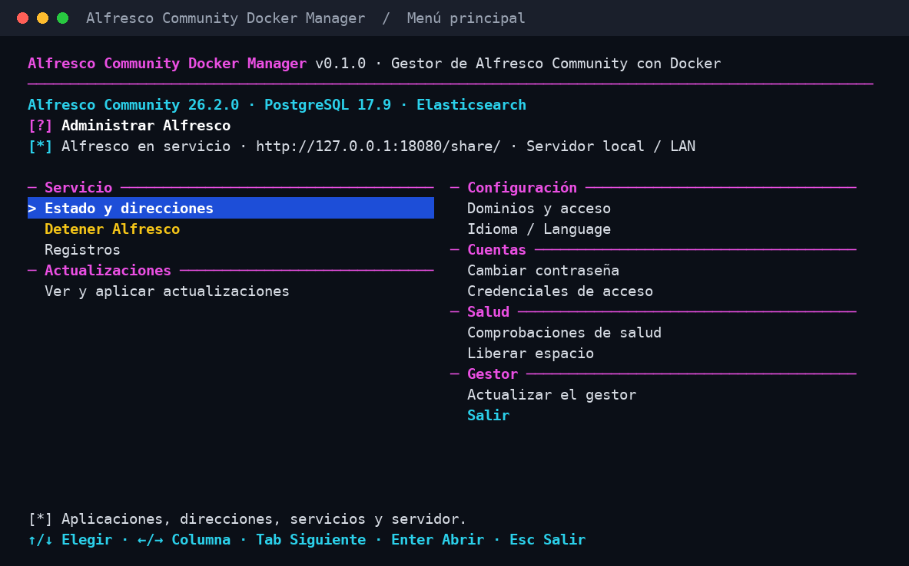
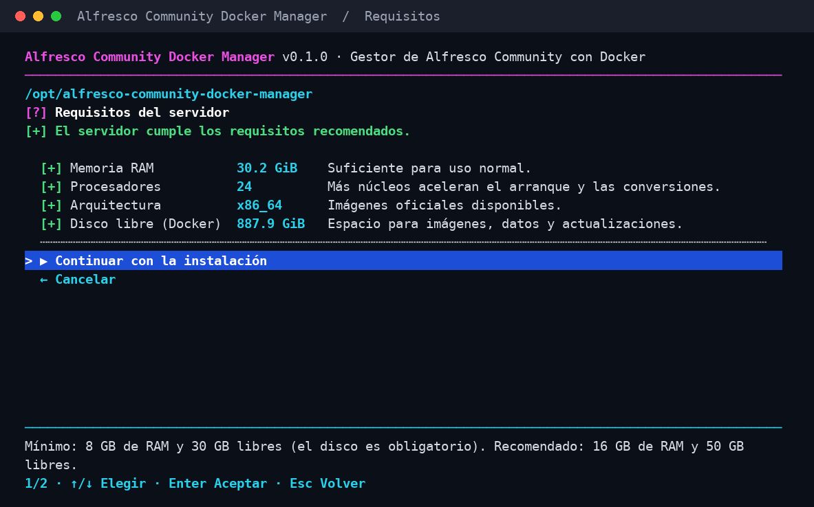

**Español** | [English](README.en.md)

# Alfresco Community Docker Manager

Instala y administra **Alfresco Community** en tu servidor Linux desde un menú
sencillo, sin escribir archivos de configuración. Usa las imágenes oficiales de
Alfresco con Docker y tiene interfaz en español e inglés.

Versión **0.1.0** · [Licencia MIT](LICENSE)



*Menú principal con una instalación en marcha.*

## Qué puedes hacer

- **Instalar Alfresco en minutos:** el gestor descarga la versión oficial más
  reciente y deja todo listo: Share, Content App, Control Center, búsqueda con
  Elasticsearch y base de datos PostgreSQL.
- **Entrar con seguridad desde el primer momento:** la contraseña de fábrica
  `admin/admin` se cambia sola por una segura antes de abrir el acceso.
- **Activar HTTPS:** con tu dominio (certificado gratuito de Let's Encrypt),
  con Cloudflare Tunnel o en tu red local con una CA propia.
- **Actualizar con un clic:** el gestor avisa cuando Alfresco publica una
  versión nueva y la aplica guardando antes la base de datos. Si algo falla,
  vuelve a la versión anterior.
- **Revisar el estado:** servicios, direcciones, registros y comprobaciones de
  salud, con una revisión diaria opcional.
- **Cambiar contraseñas** de cualquier usuario y **liberar espacio** de
  versiones antiguas.

## Antes de empezar

| | Mínimo | Recomendado |
| --- | --- | --- |
| Memoria RAM | **8 GB** | 16 GB |
| Disco libre | **30 GB** + tus documentos | 50 GB + tus documentos |
| Procesadores | 2 | 4 |
| Sistema | Linux de 64 bits (amd64 o arm64) con acceso **sudo** | |

También necesitas conexión a internet para descargar Alfresco. Si falta Docker
o Python, el asistente te ofrece instalarlos.

Antes de instalar, el gestor revisa tu servidor y te muestra el resultado:



- **Memoria:** con menos de 8 GB te avisa de que es probable que Alfresco no
  pueda arrancar por falta de memoria. Puedes continuar bajo tu
  responsabilidad.
- **Disco:** con menos de 30 GB libres no deja instalar; las imágenes ya ocupan
  unos 11 GB. También avisa si el disco quedaría por encima del 85 %, porque a
  partir de ahí la búsqueda deja de indexar.

## Empezar

**1. Descarga el gestor y ábrelo**

```bash
git clone https://github.com/solqubit/alfresco-community-docker-manager.git
cd alfresco-community-docker-manager
sudo bash start.sh
```

**2. Sigue el asistente**

1. Elige el idioma.
2. Elige **Instalar Alfresco** y el tipo de servidor:
   - **Servidor local:** se abre desde tu red, por ejemplo `http://192.168.1.10`.
   - **VPS:** al principio solo se abre por un túnel SSH (más seguro), hasta
     que añadas tu dominio.
3. Revisa los datos propuestos (IP, puertos, zona horaria, carpeta de datos) y
   confirma. La primera instalación tarda unos minutos.

**3. Entra en Alfresco**

Al terminar, el gestor te muestra las direcciones y la **contraseña de admin**.
Guárdala; también puedes verla después en **Cuentas → Credenciales de acceso**.

| Aplicación | Dirección |
| --- | --- |
| Alfresco Share (interfaz principal) | `http://TU_IP/share/` |
| Alfresco Content App | `http://TU_IP/content-app/` |
| Control Center (administración) | `http://TU_IP/control-center/` |

En una VPS, abre el túnel desde tu ordenador y entra en
`http://127.0.0.1:8080/share/`:

```bash
ssh -L 8080:127.0.0.1:80 usuario@IP_DE_TU_VPS
```

**4. Añade HTTPS (recomendado)**

En **Configuración → Dominios y acceso**:

- **Tu dominio en una VPS:** apunta el DNS a tu servidor, abre los puertos 80
  y 443 y añade el dominio. El certificado se pide y se renueva solo.
- **Cloudflare Tunnel:** añade el dominio en modo túnel.
- **Red local:** activa **HTTPS local** y, para evitar avisos del navegador,
  instala en tus equipos la CA que puedes exportar desde el mismo menú.

## Volver a abrir el gestor

Desde cualquier carpeta:

```bash
sudo bash /opt/alfresco-community-docker-manager/start.sh
```

Muévete con **↑ / ↓**, cambia de columna con **← / →**, entra con **Enter** y
vuelve con **Esc**.

## Actualizaciones

En **Actualizaciones → Ver y aplicar actualizaciones** verás si hay una versión
nueva de Alfresco o de sus componentes. Al aplicarla, el gestor:

1. Detiene Alfresco un momento y guarda la base de datos.
2. Actualiza a la vez todos los componentes que cambian.
3. Arranca y comprueba que todo responde.

Tus documentos no se tocan. Si la actualización se interrumpe o falla, entra en
**Recuperar operación pendiente** para continuarla o volver a la versión
anterior.

Para actualizar el propio gestor, descarga la versión nueva y elige
**Gestor → Actualizar el gestor**.

## Dónde se guardan los datos

Todo queda en **`/opt/alfresco-community-docker-manager/`**, fuera de la carpeta
descargada: configuración, documentos, base de datos, certificados y registros.
Puedes borrar la carpeta descargada después de instalar.

> El gestor no hace copias de seguridad completas. Para protegerte de la pérdida
> del servidor, usa las instantáneas de tu VPS o una copia externa del disco.

## Ayuda

- **Algo no arranca:** abre **Servicio → Registros** y elige el servicio. Si
  los servicios se cierran solos, suele faltar memoria (mínimo 8 GB).
- **Disco casi lleno:** **Salud → Comprobaciones de salud** avisa a partir del
  80 %. Usa **Salud → Liberar espacio** para borrar versiones antiguas.
- **La búsqueda no encuentra algo:** en Share, cambia el alcance a
  **Repositorio** y usa `*` para buscar parte de una palabra (`infor*`). Los
  documentos nuevos tardan unos segundos en aparecer.
- **Comandos sin menú:** `sudo bash start.sh --help` muestra todas las acciones
  (estado, actualizar, dominios, registros…).

[Pruebas realizadas](docs/VALIDACION.es.md) · Proyecto independiente basado en
GLPI Docker Manager y Nextcloud Docker Manager. Alfresco, PostgreSQL,
Elasticsearch y Caddy conservan sus propias licencias.
